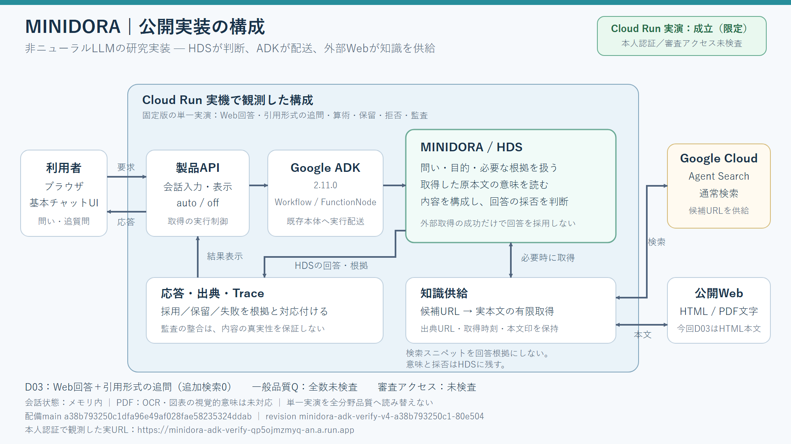

# ⚙️ ミニドラ | MINIDORA

### Transformerを使わず、LLMを構成原理から組み直す。
**巨大なニューラルネットワークを作る以外に、言語模型を成立させ、能力を増やす道はある。ミニドラは、その別ルートを実際に構築するプロジェクトです。**

既存LLMを小型化した製品ではありません。**「LLMとして成立すること」「判断すること」「知識を参照すること」「能力を増やすこと」を混同せず、別の責任構造で組み上げる**ことから始めています。中核にはニューラルネットワークやTransformerを使わず、HDSによる判断・採否、決定論的な計算、外部データ、交換可能な能力モジュールを接続します。

> **本当に挑んでいるのは、モデルの大きさではなく、能力を成立させる仕組みそのものです。**
> 論文上の構想ではなく、公開ソース、外部ベンチマーク、実際に稼働するチャット、実行Traceまで用意しています。

[English](README.en.md) · [公開実装](src/minidora/) · [製品版](製品版/README.md) · [設計](設計/README.md) · [評価](評価/README.md) · [公開境界](PUBLICATION_BOUNDARY.md)

## 数字で見る、別原理の実装

| 実証の切り口 | 観測した結果 | ここに意味がある |
|---|---|---|
| **再学習せず能力を増設** | **GPQA Diamond：29/198 → 80/198、正答純増+51、既存正答退行0**（2026-09-09、同一run・LIVE参照） | 模型核を再訓練・大型化・置換せず、科学能力モジュール追加がシステムの実効性能向上として作用した |
| **非ニューラル中核の単独測定** | **40/198（20.20%）**（2026-09-27、全198問LIVE） | 外付け専門モジュールなしの別系列。198問すべてを1問1回の問題束形成で評価 |
| **動くチャットの実装** | Google ADK 2.11.0／Cloud Runで算術、Web本文に基づく回答、会話内での引用形式変更、Trace照合を観測（2026-10-13） | 非ニューラル中核とHDSの実行系を、研究室内のスコアだけでなく実サービスへ接続 |

**最大のポイントは、29→80という正答差そのものではありません。**
既存の模型核をそのままにして、**能力を外側から追加することが、単なる拡張性の設計ではなく、実際の性能向上操作として働いた**という点です。これは「能力を増やすには模型核全体の再学習が必要」という発想に対し、少なくとも観測した科学問題領域で実装された対案です。

2026-09-09のMINIDORA80は**80/198＝40.40%**。GPQA原論文が報告した当時のGPT-4ベースライン**約39%と同じ40%前後のスコア帯**に位置します。ただし、対象subsetと参照・実行条件は完全同一ではないため、**GPT-4への同条件勝利や総合能力の同等性を意味しません**。[MINIDORA80実測正本](評価/GPQA_Diamond_MINIDORA80_Module_E2E_正本_2026-09-09.md)／[GPQA原論文](https://arxiv.org/abs/2311.12022)。

## 何が従来のLLM開発と違うのか

- **LLMの成立と、現行の実装方式を分離する。** ニューラルネットワークやTransformerを、言語模型の定義そのものと同一視しない。
- **言語模型と判断主体を混同しない。** 非ニューラル模型核とHDSの判断・採否・保留を別の責任として接続する。
- **能力の追加を、模型核の再訓練から切り離す。** 計算、専門能力、知識参照を必要な条件で作用させ、既存の成立を保持する。
- **外部知識・計算・実行証拠を扱う。** 検索結果の見出しだけで回答を代行せず、取得本文、回答の根拠、Traceの対応を検査する。
- **完成宣言より実測を優先する。** 現行統合コード、過去の中核性能、能力モジュール込み性能、Cloud実演をそれぞれ別系列で管理する。

**これは主流LLMの「安価な代用品」を目指す仕事ではありません。モデルと能力の作り方を、もう一度選び直せるようにするための研究開発です。**

現行実装は2026-10-01の三系統統合・目的依存駆動を基点に発展しています。**2026-09-27の40/198は最新実装を再測定した数値ではありません。** 最新チャットの一般品質、汎用的な性能優位性、永続会話記憶も完成と主張しません。[現行正本と履歴](CURRENT_CANONICAL.md)を参照してください。

**動作を見る：** [3分のCloud実演動画](https://youtu.be/q7hF26QBabI) · [製品版の起動方法](製品版/README.md)

公開版では内部理論の完全定義・固定参照先・理論から実装への完全対応表は公開しません。公開対象はコード、契約、局所試験、評価結果と、その成立境界です。[公開方針](PUBLICATION_BOUNDARY.md)。

---

## Google ADK／Cloud Run 展示用基本チャット

既存MINIDORAのHDSが問い、必要な根拠、資料の意味、回答の採否を扱い、Google ADK 2.11.0のWorkflow／FunctionNodeから同じ本体へ実行を配送します。根拠が不足する場合は管理者の許可内で検索し、実Web本文を取得します。検索スニペットや外部生成LLMを回答の代行にしません。

2026-10-13、本人認証でのD03実演に続き、本人承認済みの審査用Basic認証入口で実HTTPS応答を確認しました。以下は固定版の限定的な実機観測であり、一般チャット全体の品質評価ではありません。

| 展示情報 | 実測・現在の状態 |
|---|---|
| 実Cloud Run URL | [https://minidora-adk-verify-qp5ojmzmyq-an.a.run.app](https://minidora-adk-verify-qp5ojmzmyq-an.a.run.app)。HTTP Basic認証必須、Googleログイン不要 |
| 現在のrevision | `minidora-adk-verify-judge-d2397cc3fc08-7234f7` |
| 配備main／HDS本体コード復元点 | `d2397cc3fc08330c9be59eb76211299c65f8e0ee`／`45a383943df8fc58666689ee8e1e8f90de1c26be` |
| Cloud Build／image digest | `49ceef54-1446-46bf-bc92-cd44254c2eef`／`sha256:951be8ea0978ff8d08bf14de7fdf8e68ee5c433faade600468b0cd255e8b217d` |
| 審査アクセス | Basicだけを使うHTTPS検査19件・実応答3件を確認。通常ブラウザでの資格入力から回答表示までは未確認 |
| 約3分の実演動画 | [YouTube公開動画](https://youtu.be/q7hF26QBabI)。180秒、旧a38 revisionの本人認証付き実演を収録 |
| 一般チャット品質Q | 全数未検査・未成立。Cloud実演・提出とは別に評価 |



[構成図SVG](docs/minidora-cloud-architecture.svg)／[構成図PNG](docs/minidora-cloud-architecture.png)。現在の図はd2397の審査用Basic認証境界を示します。動画内の図と実画面は、先に収録した旧a38の本人認証付き構成です。HDS本体・ADK配送・検索処理は同じで、d2397ではHTTP認証境界を追加しています。

### 審査用d2397で観測した範囲

本人承認後、対象サービスに`allUsers`の`roles/run.invoker`だけを追加し、既存の本人権限とサービス構成を維持しました。アプリの全入口でBasic認証を要求し、Host/Origin・入力・頻度・監査の境界を維持しています。Googleの本人OIDCを取得・使用しないHTTPS検査19件で、UI・静的ファイル・health・capabilities、以下の3応答とTraceの取得を確認しました。

| 入力 | 実応答・採否 | 実HTTP所要秒 |
|---|---|---:|
| `8*9` | `72`、APPROVE | 6.078 |
| `藻場とは何か。` | `藻場は海藻が茂る場所です。`、APPROVE | 14.453 |
| 同じ会話で `引用形式にして` | `> 藻場は海藻が茂る場所です。`、APPROVE | 15.562 |

Web質問では検索1回・実本文1件を使い、追質問では同じ原本文を再利用して追加検索・取得HTTPが0でした。各応答でADK 2.11.0のWorkflow／FunctionNode、HDS呼出1、応答・Trace・独立v2監査の11項目が一致しました。無資格の6入口と誤資格のhealthは401、別Originは403、不正JSONは400でした。これは有限の実機検査であり、全受入CLIや一般品質Qを代替しません。

### 旧a38 D03で観測した範囲

| 入力 | 実応答・採否 | 実HTTP所要秒 |
|---|---|---:|
| `2+3` | `5`、APPROVE | 9.860 |
| `3*7` | `21`、APPROVE | 4.641 |
| 算術後の `詳しく説明して` | SUSPEND。継承する採用目的の意味構造がないとして確認待ち | 0.766 |
| `藻場とは何か。` | `藻場は海藻が茂る場所です。`、APPROVE | 16.125 |
| 同じ会話で `引用形式にして` | `> 藻場は海藻が茂る場所です。`、APPROVE | 15.032 |

藻場の質問では、許可引数を指定せず、HDSの要求から検索1回・実本文1件を取得しました。回答は[環境省の「藻場とは」](https://www.env.go.jp/water/heisa/heisa_net/setouchiNet/seto/g1/g1chapter3/mobahigata/mobatowa/index.html)の「藻場とは、海藻が茂る場所のことです。」に対応します。同じ会話の引用形式への追質問は、この原資料を再利用し、追加検索・取得HTTPは0でした。この題材は開発時にも扱っており、初見独立品質評価の合格例には算入しません。

旧a38のrevision `minidora-adk-verify-v4-a38b793250c1-80e504`、main `a38b793250c1dfa96e49af028fae58235324ddab`で、5応答すべてがADK 2.11.0のWorkflow／FunctionNodeを通り、各要求のHDS呼出数は1でした。応答ごとの11項目の技術照合が成立し、独立した監査v2の再計算も一致しました。UI・health・capabilitiesは認証付きHTTP 200、未認証アクセスは403、別Originは403、不正JSONは400を観測しています。

起動と取得方針は [製品版README](製品版/README.md) と [Cloud Run配備案内](deploy/CLOUD_RUN.md) を参照してください。審査員向けの操作手順は、上記HTTPS URLを開き、非公開欄で提供するusername/passwordを入力した後、「藻場とは何か。」、同じ会話で「引用形式にして」を送り、出典とTraceを確認するものです。資格を公開README、URL、画像、動画へ記載しません。取得許可は毎回指定する必要はなく、管理者の`auto`方針内でHDSが必要性を判断します。

初回の新Basic入口はCloud IAMの本人認証も維持して受け入れ、その後、本人承認の手動操作で審査公開に切り替えました。旧a38の動画と新Basicの非公開IAM時のUI確認は、本人認証の中継を使いました。公開後の操作環境では直接Basic到達が制限され、中継UIの1試行も接続確認中のまま、チャット要求を開始せず終了しました。通常ブラウザの認証ダイアログからUI実応答までの受入は未確認で、前記のHTTPS検査と区別します。通常の配備workflowは非公開IAMを前提とし、公開済みサービスへの無断再配備を拒否します。設定と手動審査公開modeは[Cloud Run配備案内](deploy/CLOUD_RUN.md#審査用basic認証と手動公開mode)を参照してください。

会話状態はメモリ内に限られ、再起動・新revision・インスタンス交換で失われます。PDFのOCRや図表の視覚的意味は未対応です。監査ハッシュの整合を回答の真実性の単独保証とは扱いません。180秒の[公開動画](https://youtu.be/q7hF26QBabI)は旧a38の実ブラウザ画像を時系列で編集した間欠収録です。連続録画ではなく、収録時の通信エラー1回と再送後の成功を含めています。一般品質Qは未成立です。応募受付は別の提出操作で確認します（[Zennプロジェクトページ](https://zenn.dev/hackathons/google-cloud-japan-ai-hackathon-vol5/projects/4d372c1f56834c)）。下記のGPQA値は別系列・別時点の評価であり、この展示の一般チャット品質を表す値ではありません。

## 性能の正本と履歴

**現行実装（2026-10-01の統合正本、および10月13日までの追加実装）は、GPQA Diamond全198問を再測定していません。** 以下の40/198は2026-09-27に測った中核の性能正本であり、最新コードの実測値と混同しません。評価系列も分けて扱います。

| 評価系列 | 状態 | GPQA Diamond | 意味 |
|---|---|---:|---|
| 2026-10-01以降の統合実装 | **実装更新済み・性能未再測定** | ― | 中核・統合駆動・チャット追加版の198問全数実測は未成立 |
| 2026-09-27中核 | **性能正本（新実装は未再測定）** | **40 / 198 (20.20%)** | HDS構文化器Kernelを単一意味正本とし、当時の`HDS駆動コア.選択実行`から直接実測 |
| MINIDORA30 | 履歴セーブポイント | 30 / 198 (15.15%) | 2026-09-09の旧模型核系列 |
| MINIDORA80 | 履歴セーブポイント | 80 / 198 (40.40%) | 2026-09-09の旧能力モジュール込み系列 |

2026-09-27の現行中核正本は、GPQA Diamond 198問全数を `LIVE_ONLY` 参照で実測し、**40 / 198**。初期継承状態36正答から最終40正答へ改善し、実行内退行0、最終全候補被覆198/198、一問一問題束形成198/198を確認しています。

固定参照資料・保存済み検索結果・問題別再生束は現行正本性能評価へ使用しません。別run、および独立LIVE参照を使うpaired比較の得点差をコード変更だけの純粋因果差とは扱いません。

MINIDORA80は能力追加方式の履歴実証として保持します。同一run controlled A/Bでは能力モジュールOFF 29 / 198、ON 80 / 198、正答純増+51、退行0でした。これは現行中核40 / 198とは別系列です。

正本:
- [現行正本案内](CURRENT_CANONICAL.md)
- 現行実装正本: 2026-10-01 三系統統合・目的依存駆動実装（復元点は [開発正本履歴](開発正本履歴.md)）
- [現行性能正本 40/198（2026-09-27実測）](評価/GPQA_Diamond_MINIDORA_中核_正本_2026-09-27.md)
- [評価契約 v3](評価/評価契約_v3.md)
- [開発正本履歴](開発正本履歴.md)

## MINIDORAの構成方針

MINIDORAは次を分離します。

```text
模型核
├─ 非ニューラル言語模型
├─ 汎用能力
├─ 汎用計算
├─ 外部参照
└─ 実行・監査

能力モジュール
├─ 会話
├─ 要約
├─ 抽出
├─ 計算
├─ 知識参照
└─ 追加可能な専門・汎用能力
```

能力追加は模型核の再学習・fine-tuning・大型化と同義ではありません。成立済み模型核の外側へ能力を追加し、不成立時は既存経路へ透過または保留します。

構文化・状態差・再照合等の詳細は、公開範囲で [設計/](設計/)・[構文化/](構文化/)・試験に分離して保持しています。

## 統合運用

インストール:

```bash
python -m pip install -e .
```

統合運用:

```bash
python -m minidora.製品版 --HDS --serve
```

製品版:

```bash
python -m minidora.製品版 --serve
```

HTTP:

```text
POST /api/chat
GET  /api/trace/{trace_id}
GET  /api/capabilities
GET  /health
```

詳細: [製品版README](製品版/README.md)

## 評価と履歴

次を同一視しません。

```text
厳密言語模型成立
!= 推論機構成立
!= 模型核性能
!= 能力モジュール込み性能
!= 製品完成度
!= Large
```

GPQAはLLM定義そのものではなく、同一問題集合で機構差・能力差を観測する評価面として使用します。

過去の作業ログ・旧評価個票はdefault treeへ重複保存しません。採用された開発正本の節目と復元commitは [開発正本履歴](開発正本履歴.md) に集約します。`構文化/` はMINIDORA構築の原観測・構築原料として保全します。

## リポジトリ

| 場所 | 責任 |
|---|---|
| [`src/minidora/`](src/minidora/) | 現行実装 |
| [`tests/`](tests/) | 単体・回帰・受入試験 |
| [`設計/`](設計/) | 公開可能な局所設計・互換境界 |
| [`評価/`](評価/) | 現行正本・現行能力の受入証拠 |
| [`docs/`](docs/) | 現行の補助文書 |
| [`構文化/`](構文化/) | 観測・構文化履歴 |
| [`製品版/`](製品版/) | 製品版案内 |
| [`artifacts/`](artifacts/) | 小さな固定成果物のみ |

全数ベンチの巨大JSON・固定参照束はdefault treeへ置かず、GitHub Actions artifactまたは評価サマリへ分離します。

## 日本語基底

MINIDORAが自ら定義する内部意味は日本語を正本とします。英語その他は外部規格・API・識別子・国際公開等の境界で使用します。

- [日本語基底規定](設計/00_日本語基底規定_v1.md)
- [日本語正本語彙](設計/01_日本語正本語彙_v1.md)
- [参照正本](参照正本.md)

## 検証

```bash
python tools/リポジトリ整合性監査.py
python tools/日本語基底監査.py
python tools/日本語基底詳細監査.py
python tools/公開境界監査.py
python -m compileall -q src tests tools
python -m unittest discover -s tests -q
```

## ライセンス

- ソースコード・実装: **Apache License 2.0** — [LICENSE-APACHE-2.0](LICENSE-APACHE-2.0)
- 仕様・設計・評価・README等: **CC-BY-4.0** — [LICENSE-CC-BY-4.0](LICENSE-CC-BY-4.0)
- 適用範囲: [LICENSE](LICENSE)
- 帰属・第三者由来物: [NOTICE](NOTICE)

## Author

**がっちむち♂**
